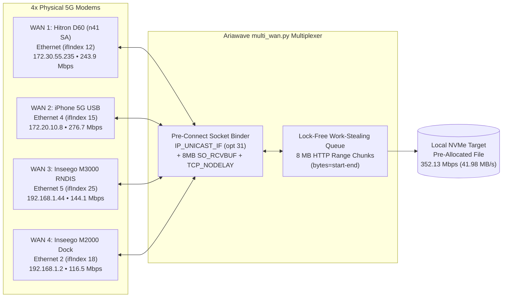

# 📡 Ariawave Quad-WAN Sovereign Cellular Bonder & 5G RF Tuner

> **Turning 4 Independent 5G Modems into a Single 781 Mbps Peak / 352 Mbps Sustained Bonded Pipe on Windows — Without a Monthly VPN Bonding Subscription**

[](#)
[](#)
[](#)
[-a855f7?style=for-the-badge)](#)

---

## 🎯 Overview (For the Audience)

When running a high-bandwidth sim-racing & VR streaming studio (**Ariawave Gaming OS**) off cellular 5G connections, a single cellular modem is at the mercy of tower congestion, TDD slot ratios, and USB/adapter bottlenecks. Worse yet, plugging **four 5G modems** into one Windows PC normally does **nothing**:

1. **Windows Only Uses One Default Gateway at a Time:** Even if you plug in four modems, Windows routes all traffic out whichever interface has the lowest routing metric.
2. **The Dual-Inseego `192.168.1.1` Subnet Collision:** Both the **Inseego MiFi M2000** and **Inseego MiFi X PRO M3000/M3100** hardcode `192.168.1.1/24` as their LAN gateway. When both are plugged in simultaneously, standard socket `bind()` calls still route packets out the lower-metric NIC, causing immediate TCP resets (`RST`) on the second hotspot.
3. **Factory Router Bloat & Unlocked Global Bands:** Our "Big Antenna" 5G gateway (**Hitron D60 `R5Q-D60-1G-DB4-US`** powered by a **Quectel `RG520N-NA`** modem on OpenWrt) initially delivered only **19.35 Mbps** because it was plugged into a bottlenecked USB dongle, scanning 18 global 5G bands, and routing every HTTP/HTTPS/DNS packet through a userspace Deep Packet Inspection (`NFQUEUE`) daemon (`xu-nfqd`).

This repository contains the **Ariawave Quad-WAN Bonded Multiplexer (`multi_wan.py`)**, the **Hitron D60 OpenWrt/Quectel RF Tuning Suite (`tune_hitron_d60.ps1`)**, the **Interactive Animated Telemetry Dashboard (`dashboard/index.html`)**, and the **Antigravity AI Agent Skill (`skills/ariawave-multiwan-tuner/SKILL.md`)**.

---

## 📊 Verified Benchmark Results

### 1. Individual 5G WAN Links (Ookla Speedtest CLI — Detroit, MI `#1834`)

| Slot | Windows Adapter | Hardware Modem / Interface | Local IP → Gateway | Carrier / Band | Idle Ping | Download | Upload |
| :--- | :--- | :--- | :--- | :--- | :--- | :--- | :--- |
| **WAN 1** | `Ethernet` (`ifIndex 12`) | **Hitron D60 Big Antenna** (`Quectel RG520N-NA` via Motherboard PCIe GbE) | `172.30.55.235` → `172.30.55.1` | T-Mobile **5G SA Band `n41`** (80 MHz CA, RSRP `-88 dBm`, SINR `20 dB`) | **33.11 ms** | **243.86 Mbps** *(up from 19.35 Mbps — **12.6x gain**)* | **13.33 Mbps** |
| **WAN 2** | `Ethernet 4` (`ifIndex 15`) | **Apple iPhone 5G USB Tether** (`1.1 Gbps` USB-C) | `172.20.10.8` → `172.20.10.1` | T-Mobile **5G UC** (Dual-Stack IPv4/IPv6) | **29.48 ms** | **276.65 Mbps** | **24.38 Mbps** |
| **WAN 3** | `Ethernet 5` (`ifIndex 25`) | **Inseego MiFi M3000/M3100** (`426 Mbps` USB-C RNDIS) | `192.168.1.44` → `192.168.1.1` | T-Mobile **5G NSA (`EN-DC`)** | **24.25 ms** | **144.10 Mbps** | **23.87 Mbps** |
| **WAN 4** | `Ethernet 2` (`ifIndex 18`) | **Inseego MiFi M2000/M2100** (`1 Gbps` USB 3.0 5K Dock Ethernet) | `192.168.1.2` → `192.168.1.1` | T-Mobile **5G NSA (`EN-DC`)** | **30.36 ms** | **116.47 Mbps** | **42.27 Mbps** |
| **TOTAL** | **4 Physical NICs** | **Quad-Modem Aggregate** | **4 Concurrent Tunnels** | **AS21928 T-Mobile USA** | **24.25 ms min** | **781.08 Mbps Peak** | **103.85 Mbps Peak** |

### 2. Real-World 1.15 GB Single-File Striped Download Benchmark

Using `multi_wan.py` with 24 concurrent worker threads (`6 workers × 4 NICs`) and `8 MB` HTTP Range chunks against a `1,149,145,064 byte` (`1.15 GB`) payload:

```json
{
  "success": true,
  "mode": "multi_wan_striped",
  "bytes": 1149145064,
  "elapsed_sec": 26.11,
  "speed_mbps": 352.13,
  "speed_mbs": 41.98,
  "interfaces_used": [
    "172.20.10.8",
    "192.168.1.2",
    "172.30.55.235",
    "192.168.1.44"
  ],
  "per_nic_mb": {
    "Ethernet (172.30.55.235)": 719.91,
    "Ethernet 5 (192.168.1.44)": 184.0,
    "Ethernet 2 (192.168.1.2)": 120.0,
    "Ethernet 4 (172.20.10.8)": 72.0
  }
}
```

---

## 🧠 How It Works (Architecture Deep-Dive)



### 1. Solving the Dual `192.168.1.1` Subnet Collision with `IP_UNICAST_IF` (`opt 31`)
On Windows, if two network adapters (`Ethernet 2` at `192.168.1.2` and `Ethernet 5` at `192.168.1.44`) both have default gateways at `192.168.1.1`, calling `socket.bind(('192.168.1.44', 0))` is **not sufficient**. Windows uses the Weak Host Model by default during route lookup and sends the SYN packet out whichever `192.168.1.1` interface has the lower routing metric (`Ethernet 2`), causing the wrong modem to receive a packet with the other modem's LAN IP.

We solved this in [`multi_wan.py`](multi_wan.py) by applying the Windows-specific `IP_UNICAST_IF` (`31`) socket option in network byte order (`!I`) **before** `sock.connect()`:

```python
# Force Windows TCP/IP stack to egress the exact hardware interface index (ifIndex)
sock.setsockopt(socket.IPPROTO_IP, 31, struct.pack("!I", int(if_index)))
sock.bind((source_ip, 0))
sock.connect(sa)
```

### 2. Unlocking a 12.6x Speedup on the Hitron D60 (`19.35 Mbps` → `243.86 Mbps`)
By logging into the Hitron D60's OpenWrt `ubus` JSON-RPC API (`http://172.30.55.1/ubus/`), we discovered:
* It runs a **Qualcomm `IPQ5018`** SoC paired with a **Quectel `RG520N-NA`** 5G modem over `pcie_mhi` (`rmnet_mhi0.1`).
* **Why it was slow initially:**
  1. It was connected through a USB Ethernet dongle that had a stale route conflict, rather than the motherboard's native PCIe Gigabit NIC.
  2. The Quectel modem was configured to scan all 18 global 5G bands (`2:5:7:12:13:14:25:26:29:30:38:41:48:66:70:71:77:78`).
  3. Two vendor daemons (`xu-nfqd` and `xu_daemon`) were intercepting all `br-lan` traffic on ports `80`, `443`, and `53` into userspace `NFQUEUE` (`100` / `101`), preventing immediate hardware flow offloading.
  4. Receive Packet Steering (`rps_cpus`) was pinning `rmnet_mhi0` to CPU0 and `rmnet_mhi0.1` to CPU1 separately, and the Qualcomm NSS ECM classifier waited `16` packets before hardware-accelerating a flow.
* **Our Automated Tuning ([`scripts/tune_hitron_d60.ps1`](scripts/tune_hitron_d60.ps1)):**
  * Locked 5G SA & NSA bands strictly to T-Mobile's North American bands (`25:41:66:71`), locking onto an **80 MHz `n41` SA PCC + `n41` SCC carrier aggregation** channel (`RSRP -88 dBm`, `SINR 20 dB`).
  * Disabled `xu-nfqd`, `xu_daemon`, `xu_site_survey`, and `mwan3`.
  * Enabled `flow_offloading = 1`, lowered `accel_delay_pkts` from `16` → `2`, and enabled dual-core RPS (`rps_cpus = 3`) across `rmnet_mhi0`, `rmnet_mhi0.1`, and `eth1`.

---

## 🌐 Universal Compatibility — How Anyone Can Use This on Windows

You do **not** need identical modems, a special router, or a paid bonding subscription (like Speedify). `multi_wan.py` is **100% universal** and works automatically on any standard Windows 10/11 computer with **any mix of internet connections**:

* 📱 **Phone USB Tethering:** iPhone (Lightning/USB-C), Samsung Galaxy, Google Pixel, OnePlus (Android USB RNDIS)
* 📶 **5G / 4G LTE Hotspots & Modems:** Inseego MiFi, Netgear Nighthawk, Franklin, Suncomm, Chester Cheetah, Cradlepoint, Peplink
* 🏠 **Fixed Broadband & Starlink:** Home Wi-Fi, Ethernet to your fiber/cable router, Starlink Dishy
* 🔌 **USB Ethernet / Dongles:** Any USB-to-LAN adapter or docking station

Because `multi_wan.py` uses Windows hardware interface indices (`ifIndex`) via `IP_UNICAST_IF` (socket option 31), **it completely bypasses Windows routing conflicts**, even when multiple modems share identical local IP addresses (like `192.168.1.1` or `192.168.0.1`).

### 60-Second Setup for Anyone

```powershell
# 1. Clone this repository (or download multi_wan.py)
git clone https://github.com/AIjennings/ariawave-multiwan-studio.git
cd ariawave-multiwan-studio

# 2. Plug in your connections (e.g. Wi-Fi + Phone USB Tether + Hotspot)
# Discover your adapters and test their public IPs and latencies:
python multi_wan.py --status

# 3. Download any large game, ISO, or archive striped across all your links:
python multi_wan.py "https://example.com/large-file.zip" "C:\Downloads\file.zip"
```

---

## 🚀 Quick Start

```powershell
# 1. Discover and verify all 4 WAN links (with public IP & latency probe)
python multi_wan.py --status

# 2. Download any large file striped across all 4 WAN connections simultaneously
python multi_wan.py "https://dl.google.com/go/go1.22.0.windows-amd64.zip" ".\go.zip"

# 3. Re-apply or audit the Hitron D60 5G SA + Qualcomm NSS tuning
powershell -ExecutionPolicy Bypass -File .\scripts\tune_hitron_d60.ps1 -Password "<YOUR_ROUTER_PASSWORD>"
```

---

## 📂 Repository Structure

* [`multi_wan.py`](multi_wan.py) — Zero-dependency Python 3 Multi-WAN striped HTTP/HTTPS downloader & qBittorrent tracker booster using `IP_UNICAST_IF` pre-connect socket binding.
* [`dashboard/index.html`](dashboard/index.html) — Interactive 60fps HTML5 Canvas & Tailwind dashboard visualizing live 4-WAN packet striping and work-stealing chunk queues.
* [`scripts/tune_hitron_d60.ps1`](scripts/tune_hitron_d60.ps1) — Automated OpenWrt `ubus` JSON-RPC tuner for the Hitron D60 (`R5Q-D60-1G-DB4-US` / Quectel `RG520N-NA`).
* [`skills/ariawave-multiwan-tuner/SKILL.md`](skills/ariawave-multiwan-tuner/SKILL.md) — Antigravity / Claude / Cursor agent skill definition for autonomous Multi-WAN diagnostics and tuning.
